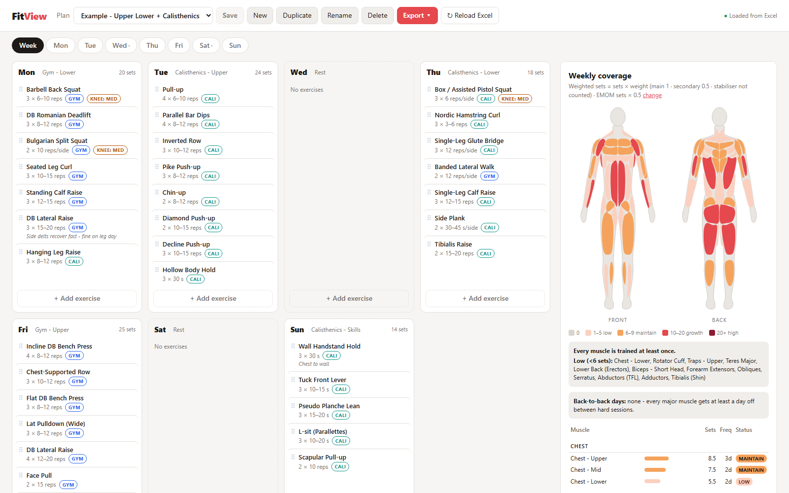
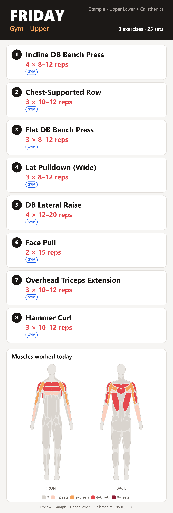
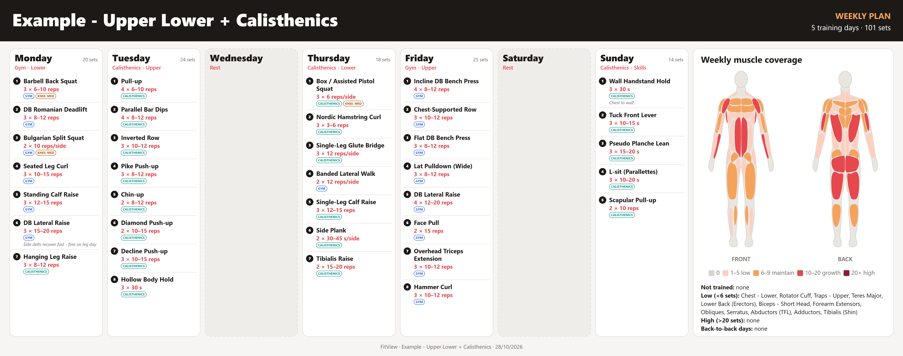

# FitView

**Plan your training week and see exactly which muscles it hits, down to upper/mid/lower chest and all three delt heads.**

FitView is a small local web app for people who mix **gym training and calisthenics**. You build a weekly plan from a library of 145 exercises and a front/back body map shows your weekly volume per muscle, what's under-trained, and where the same muscle is hit hard on two days in a row. Everything is stored in plain **Excel files** you own and can edit.



## Features

- **Weekly planner:** 7 day columns, drag and drop to reorder or move exercises between days, single-day view.
- **Body map with 34 muscle regions:** chest (upper / mid / lower), delts (front / side / rear), both biceps and triceps heads, forearm flexors / extensors, core, glutes, adductors, tibialis and more.
- **Weekly volume per muscle** with colour bands (low → maintain → growth → high) and a coverage table.
- **Back-to-back check:** warns when a muscle is trained hard on consecutive days (Sunday → Monday included).
- **145-exercise library** (gym + calisthenics skills like planche, front lever, handstand), each with main / secondary / stabiliser muscles, default sets/reps and a knee-load flag.
- **Add-exercise picker:** click a muscle on the body to find exercises for it, and filter by main or secondary role.
- **Structured entries:** sets, reps / seconds / minutes / metres, per side, load (kg, +kg weighted, -kg assisted, band), and EMOM.
- **Counting settings:** EMOM sets count less than hard sets; stabiliser credit is configurable.
- **Exports:** a PDF (one page per day plus a weekly summary), phone-sized day cards for the gym, and a one-image week overview.
- **Manual save, hide exercises** to try "what if" without deleting, plan duplicate / rename / delete (deleted plans are kept in a folder, never erased).
- **Your data stays local:** no account, no cloud. Plans are `.xlsx` files you can open in Excel.

| Day card (phone) | Week overview |
|---|---|
|  |  |

## Quick start

You need **Python 3.10+**. PDF export also needs **Chrome, Edge or Chromium**.

```bash
git clone https://github.com/Vichu95/FitView.git
cd FitView
```

Then start it:

- **Windows:** double-click `start.bat`
- **macOS / Linux:** `./start.sh`
- **Any system:** `pip install -r requirements.txt` then `python -m fitview`

The app opens in your browser at `http://127.0.0.1:8765`. On first run it creates a `workspace/` folder with your library workbook and three example plans.

```text
workspace/
  FitView.xlsx          <- exercise library, muscles, counting settings (edit in Excel)
  Plans/
    Example - Full Body 3x.xlsx
    Example - Upper Lower + Calisthenics.xlsx
    Example - Calisthenics 3x.xlsx
    _deleted/           <- deleted plans end up here
```

Options: `python -m fitview --help` (`--workspace PATH`, `--port N`, `--no-browser`). You can also set `FITVIEW_HOME` to keep your workspace somewhere else, e.g. in a synced folder.

## How it works

- **Each plan is one Excel file** with the columns Day, Session, Exercise, Sets, Amount, Unit, Per Side, Load, Load Type, EMOM, Hidden, Notes.
- **Volume** = sets × muscle weight, where main = 1, secondary = 0.5 and stabiliser = 0 by default. EMOM sets count × 0.5 by default.
- **Weekly bands:** below 6 low, 6–9 maintain, 10–20 growth, above 20 high.

These are evidence-informed estimates, not exact measurements. Read **[how counting works](docs/methodology.md)** to understand what the numbers mean and where they mislead.

The example plans are **starting points**. The coverage panel shows where each one could use more work. Duplicate one and make it yours.

## Customising

Add exercises, change muscle weights or edit plans directly in Excel. See **[docs/customising.md](docs/customising.md)**.

## Contributing

Exercise suggestions and muscle-weight corrections are very welcome. See **[CONTRIBUTING.md](CONTRIBUTING.md)**.

## Disclaimer

FitView is a planning tool, **not medical or coaching advice**. Muscle weights and volume targets are estimates. If you have an injury or pain, talk to a qualified professional before changing your training.

## License

- Code: [MIT](LICENSE)
- Exercise library and example plans (`data/`): [CC BY 4.0](data/LICENSE.md)
